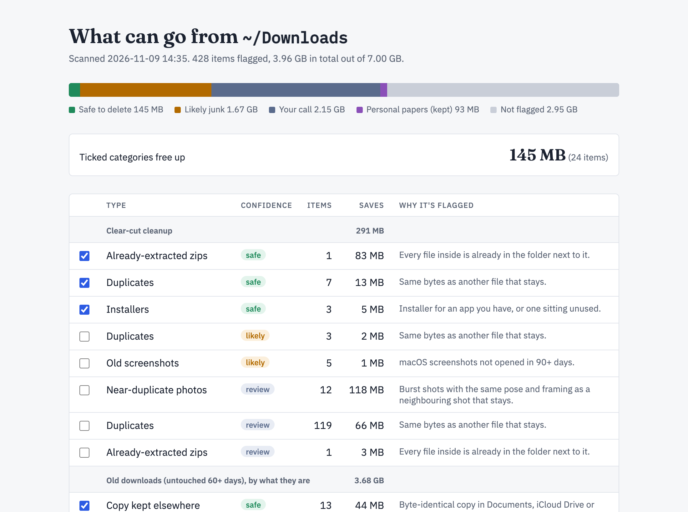
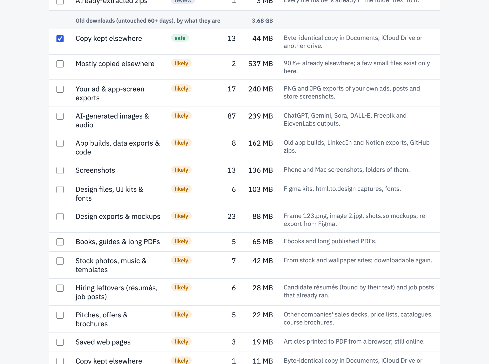
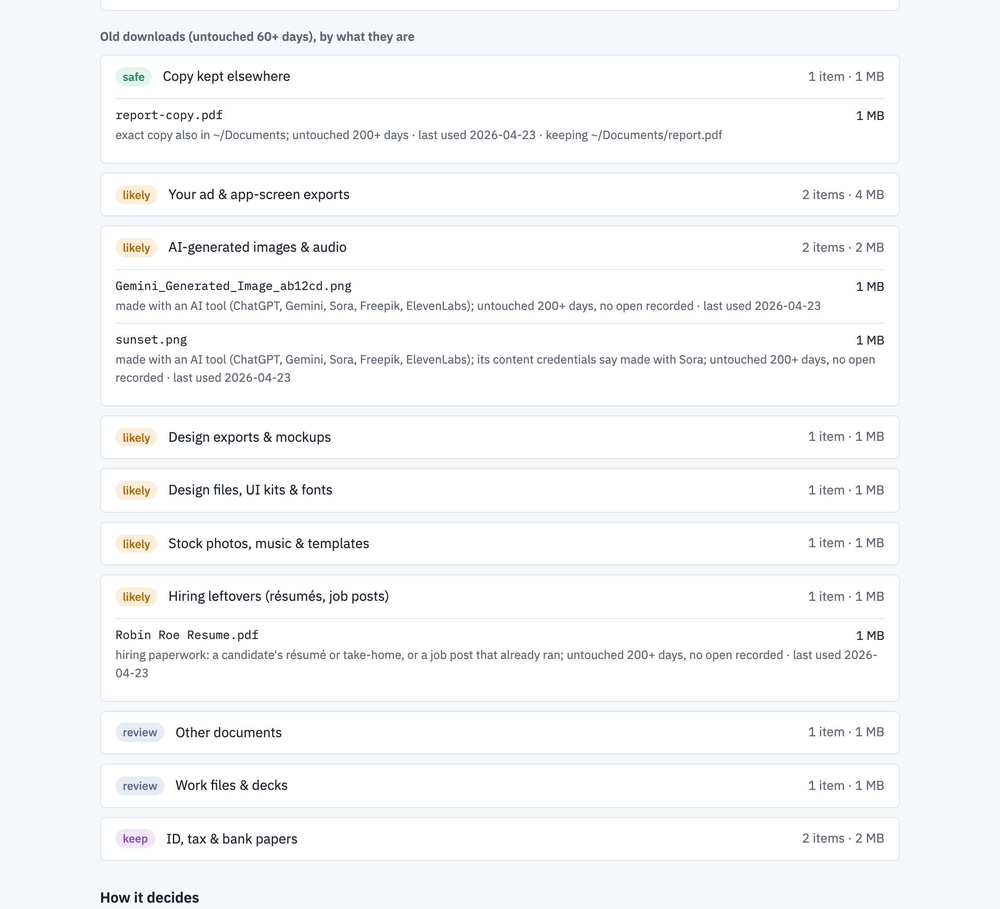

<div align="center">

<h1>declutter</h1>

<p><b>Find out what you can safely delete from your Mac's Downloads folder.</b><br>
It opens every file, works out what it is, and shows you what can go. It never deletes anything.</p>

<p>
<a href="https://github.com/antivirusakash/declutter/actions/workflows/test.yml"></a>


<a href="LICENSE"></a>
</p>

<picture>
  <source media="(prefers-color-scheme: dark)" srcset="docs/hero-dark.png">
  
</picture>

<sub>A real scan of the author's 7 GB Downloads folder.</sub>

</div>

<br>

**Your Downloads folder is full, and you're scared to empty it.** Somewhere in there is your passport scan. Next to it are dozens of AI images you made once, a résumé from a hiring round that ended in March, and a hotel quote for a trip you took last year. Sorting by size or date can't tell those apart. declutter can, because it reads what's inside each file.

In the scan above, it found 1.67 GB that was probably junk and 145 MB that was safe to delete outright. The author's ID, tax and bank papers (93 MB) got their own group, set aside to keep.

## Try it

```sh
git clone https://github.com/antivirusakash/declutter && cd declutter
./run.sh && open preview.html
```

A 7 GB folder takes a bit over a minute. There's nothing to install, and none of your files leave your Mac.

To scan a different folder, run `DIR=~/Desktop ./run.sh`.

## What it finds

<picture>
  <source media="(prefers-color-scheme: dark)" srcset="docs/groups-dark.png">
  
</picture>

- **Copies you already have**, in another folder, in iCloud Drive or on an external drive. The two have to match byte for byte.
- **AI images, and which app made them.** Many AI images carry a hidden label inside the file saying what made them, and declutter reads it.
- **Stock photos, UI kits, fonts and design exports** you can download or export again.
- **Résumés and job posts** from someone else's hiring round.
- **Travel quotes and event passes whose dates have passed.** A trip next month stays.
- **Burst shots that look almost the same.** It keeps the one you marked as a pick, or else the best-looking one.
- **Photos with real people in them.** These are always held back for you to look at.
- **Your ID, tax and bank papers.** They sit in their own group, and that group is never ticked for you.

## Every file comes with a reason

Open a group and each file says why it's there and what stays if you delete it.

<picture>
  <source media="(prefers-color-scheme: dark)" srcset="docs/files-dark.png">
  
</picture>

<sub>This one is the made-up test folder from <code>tests/</code>, since a real one is full of other people's names.</sub>

## What it won't suggest deleting

Your own work. A file counts as yours when your name, username or brand shows up in its name, inside a PDF, or as text in an image. Decks, recordings and camera photos also stay in "look first", because they might be the only copy you have.

## Tell it who you are

It already knows your name and username from your Mac. If you have a brand, a company or a nickname, put it in `~/.config/declutter/config.json`:

```json
{
  "names": ["Jane", "Doe"],
  "handles": ["janedoe"],
  "brands": ["AcmeApp"],
  "work_hints": ["acme"],
  "country": "US"
}
```

`country` adds that country's ID and tax words, so a W-2 or an Aadhaar card lands in "keep". India, the US and the UK are built in.

## Does it get it right?

To test it, AI reviewers went through 290 old files on the author's Mac, opening each one. They marked every file "fine to delete", "keep" or "not sure" without seeing what declutter had said. The results:

- 99% of what declutter suggested deleting was fine to delete.
- None of it was a file worth keeping.
- It found 94% of the space that could go.

The rules were tuned on those same 290 files, so expect it to do a bit worse on yours.

## Questions

<details>
<summary><b>Will it delete my files?</b></summary>

No. It only writes a report and a web page. You decide what goes and delete it yourself in Finder.
</details>

<details>
<summary><b>Does it send my files anywhere?</b></summary>

No. Everything runs on your Mac with the Python and system tools macOS already ships with. It makes no network calls.
</details>

<details>
<summary><b>Why not just sort by size and date like other cleaners?</b></summary>

Because the biggest, oldest file in your Downloads might be the only copy of your wedding video, and a tiny one might be a candidate's résumé you should have deleted months ago. Age only decides what gets looked at. What the file is decides the suggestion.
</details>

<details>
<summary><b>Why Mac only?</b></summary>

It reads files with tools built into macOS: Spotlight for metadata and full-text search, PDFKit for PDF text, and Vision for text and faces in images.
</details>

## Limits

- Mac only. It relies on the search, PDF and image-recognition features built into macOS.
- A folder is judged as a whole. If one file inside looks personal, the whole folder is held back.
- It reads dates written in English and Hindi. Events with dates in other languages stay in "look first".

<details>
<summary>How it works, for the curious</summary>

### Signals

| Signal | Where it comes from | Used for |
|---|---|---|
| Byte-identical copy elsewhere | size, then a hash of the start and end, then a full hash; files inside zips by CRC32 | "Copy kept elsewhere" |
| Date added, last opened, camera model, page count, screenshot flag, capture time | Spotlight (`mdls`) | age, camera photos, long PDFs, screenshots |
| ID, tax and bank words inside files | Spotlight full-text search, with a word list per country | the keep group |
| PDF text and the PDF's author field | PDFKit | résumés, travel quotes, sales pitches, past events, pages printed from a browser |
| Text in images, scene labels, faces | Vision | your brand in an ad; photos of people held back |
| AI provenance (C2PA / IPTC `trainedAlgorithmicMedia`) | the file's own bytes | AI-generated images and the tool that made them |
| Feature prints, aesthetics scores, capture times | Vision, Spotlight | near-identical burst shots |
| Dates inside documents | PDF text | trips and events count as over only after their last date |

Everything runs with the system Python and `osascript`.

### Groups

- **safe**: an exact copy exists somewhere that stays, or the file is junk by construction (an unfinished download, a zip already unzipped next to itself).
- **likely**: things you can get again or whose job is over.
- **review**: things that may be the only copy of your work or memories.
- **keep**: ID, tax, bank and legal papers. They're shown so you can see the space, and never ticked by default.

### Step by step

```sh
python3 -I declutter.py --out out ~/Downloads
python3 -I check.py out/report.json          # rules every report must follow
python3 -I render.py out/report.json preview.html --total-bytes $(du -sk ~/Downloads | awk '{print $1*1024}')
```

Other config keys: `index_roots` replaces the default list of places it searches for copies (Documents, Desktop, Pictures, Movies, Music, iCloud Drive and every mounted drive).

### Scoring it on your own files

Put JSONL rows like `{"path": "/Users/you/Downloads/x.pdf", "label": "KEEP"}` in `private/labels/` and run `./run.sh`. `eval.py` prints precision and recall against your labels.

| Version | Suggested deletes that were fine | Keepers wrongly suggested | Deletable space found |
|---|---|---|---|
| Name and type rules only | 97.1% | 2 | 78.9% |
| + your own exports split from decks | 97.5% | 2 | 92.8% |
| + Vision people check | 99.0% | 0 | 92.7% |
| + C2PA provenance | 99.0% | 0 | 93.9% |
| + text and screenshot flag on leftover images | 99.0% | 0 | 94.3% |

Burst shots were checked separately. A reviewer compared each extra shot with the one that stays, and 11 of 12 were fine to drop (one had a different expression), so bursts stay in review.

### Tests

```sh
python3 -I -m unittest discover -s tests
```

`tests/make_fixture.py` builds a fake Downloads folder for a made-up owner, one file per rule. The end-to-end test checks each file lands in its group and that `check.py` passes. Aesthetics scores need macOS 15. On older systems a burst keeps its earliest shot.

### Privacy

Reports and previews contain your file names and stay in `out/`, which git ignores. Before pushing, `python3 -I privacy_check.py` fails if any tracked file contains your configured names or brands, an email address, a phone number, or the name of any file in the folders you scanned.

</details>

## License

MIT. Issues and pull requests are welcome. Run `python3 -I privacy_check.py` before you push, so nothing from your own scans ends up in the repo.
